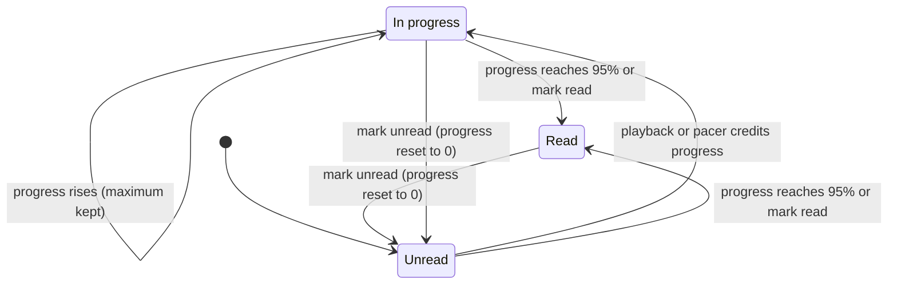

# Reading Progress — Design

**Date:** 2026-11-02
**Status:** Approved — design agreed in conversation; written spec approved by the user
**Area:** Full stack — per-user read state, Post Detail reading/listening controls, article lists
**Supersedes:** FR-029 in `specs/001-rss-feed-reader/spec.md` ("System MUST
automatically mark posts as read when opened")

## Problem

Opening an article marks it read immediately: `GET /api/posts/{id}` calls
`PostService.auto_mark_read`, and the detail page shows a "Read" chip on arrival.
"Seen" and "read" are the same thing, so:

- Tapping into a post just to look at it removes it from the Unread badge even if
  the user never read it.
- There is no way to find an article you started and did not finish.
- Continuous read-along highlighting now knows exactly which word the reader is on
  (the audio clock drives it), but that signal is thrown away.

## Goal

Separate **seeing** an article from **reading** it, and use the read-along clock to
track how far each user has read:

- Opening an article records it as **Opened** but leaves it **Unread**.
- Reading progress (0–100%) is recorded while the user reads along — with audio, or
  silently with a built-in pacer — and persisted per user.
- An article becomes **Read** automatically at 95% progress, or manually (as today).
- The sidebar filter gains an **In progress** list beside Unread and Read, and
  in-progress cards show a thin progress bar.

## Non-Goals

- No dedicated "reading history" page — the sidebar filters are the lists for now.
- No last-activity ordering and no `progress_updated_at` column. Lists stay
  newest-first by published date.
- No coverage or time-spent tracking. Progress is the **furthest point reached by
  continuous playback**, not "how much of the text was visited".
- No offline queue for progress reports; failed reports are retried while the page
  is open and dropped afterwards.
- No tap-a-word-to-jump, no native/Web Speech TTS (silent mode is a timer-paced
  highlight with no voice), no reading analytics or streaks.
- No live cross-device sync; state reconciles on the next fetch.
- No feature flag; the change ships behind one reversible migration.

## Decisions

Made with the user during brainstorming; they are not open for re-litigation in the
plan.

| # | Question | Decision | Why |
|---|----------|----------|-----|
| 1 | Entry point | One generic **Start reading** control with a sound/silent choice. It replaces the idle "Listen to article" button. Pressing play on the audio player also counts as reading. | One mental model for "I'm reading now"; sound is optional. |
| 2 | Silent pace | A built-in timer **pacer** at an adjustable words-per-minute, no TTS call. Sound mode uses the real audio clock. | Works with external TTS disabled (the default); no cost or privacy exposure. |
| 3 | Opening | An opened article stays **Unread**, is remembered as **Opened**, still counts in the Unread list and badge, and shows a subtle "Opened" marker on its card. | Separates seeing from reading without surprising badge counts. |
| 4 | Lists | Sidebar filter becomes **All / Unread / In progress / Read**; in-progress cards show a thin progress bar. No dedicated page. | Smallest UI that makes partial reads findable. |
| 5 | Approach | **A:** extend `user_posts` with a server-owned state machine, `PUT /posts/{id}/progress`, and generalise the highlight engine to a `MediaClock` with a `PacerClock`. | Server is the single source of truth and can filter/paginate lists in SQL. |

Rejected alternatives: **B** — a reading-session log table (more machinery than the
two lists need, and no feature consumes the history); **C** — client-only progress
in IndexedDB (no cross-device state, and the server cannot filter an In progress
list).

## User-Facing Behavior

### Article states

Each user/article pair carries `isRead`, `readProgress` (0–1, furthest point
reached) and `isSeen` (the user has opened it).

| State | Condition | Article card | In Unread badge / filter |
|-------|-----------|--------------|--------------------------|
| **Unread** | not read, progress = 0 | normal; an "Opened" caption if `isSeen` | yes |
| **In progress** | not read, progress > 0 | thin progress bar and a "42%" caption (progress implies opened) | yes |
| **Read** | read | dimmed, as today; no "Opened" marker | no |



"Opened" is an orthogonal flag, not a state: it is set by the first open and kept
across every transition above.

### Rules

1. **Opening never marks read.** `GET /posts/{id}` records `opened_at` (first open
   wins) and nothing else.
2. **Progress only moves forward.** The server keeps the maximum value ever
   reported.
3. **Completion at 95%.** At ≥ 95% (`READ_COMPLETION_THRESHOLD = 0.95`, defined once
   in the domain layer and applied by the service) the article flips to Read:
   `is_read = true`, `read_at = now`, progress `1.0`. Clients report a fraction and
   never decide completion.
4. **Seeking alone never credits progress.** Only continuous playback (audio) or
   pacer advance does.
5. **Manual changes.** Mark read → Read at 100%. Mark unread → Unread at 0%, keeping
   `opened_at`. Bulk mark-all read/unread does the same per article; mark-all-unread
   also clears partial progress.
6. **Read is sticky.** The progress endpoint never demotes a Read article, and
   "Read again" does not report progress.
7. **Badge and Unread filter keep today's meaning** (= not Read). Opened and
   In-progress articles stay in them; "In progress" is a subset filter.
8. **Ordering is unchanged:** newest-first by published date.

### Typical flows

- **Skim:** open an article, go back. The card now reads "Opened"; the badge count
  is unchanged.
- **Silent read:** press **Start reading** → the body highlights word by word at
  250 WPM → the card shows 12%, 40%, … → at 95% the chip flips to Read live.
- **Listen:** press play on the audio player (or **Read with sound**) → the same
  progress tracking, driven by the audio clock.
- **Finish later:** open the **In progress** filter → open the article → the button
  reads "Continue reading · 42%" and resumes there.

### Entry point: Start reading

When no reading surface is active, the idle "Listen to article" button is replaced
by a split **Start reading** button.

| Article state | Main button label |
|---------------|-------------------|
| Unread (0%) | Start reading |
| In progress | Continue reading · 42% |
| Read | Read again (starts at 0; progress is not reported) |

- The **main click** uses the last-used mode, persisted in `localStorage`
  (`readAlong.readingMode`: `"silent"` or `"sound"`; default **`"silent"`**). The
  default is silent because operator-side external TTS defaults to off
  (`external_tts_enabled = False`, `backend/app/config/settings.py:68`) and the
  audio route then answers 403 `EXTERNAL_PROCESSING_DISABLED`.
- The **arrow menu** offers "Read with sound" and "Read silently"; choosing one
  starts immediately and becomes the remembered mode.
- Sound start calls `player.generateAudio()` and then attempts to play. If the
  browser blocks autoplay, the player stays in its ready state (no progress).

### Reading surfaces

The detail page shows exactly one surface:

| Surface | When | What renders |
|---------|------|--------------|
| idle | no silent session and `player.status === "idle"` | `StartReadingButton` |
| audio | `player.status !== "idle"` and no silent session | today's `AudioPlayer`, plus a "Read silently" link |
| silent | a silent session is active | `PacerControls`, plus a "Listen instead" link |

- **Audio surface.** `AudioPlayer` keeps its ready / playing / paused / loading /
  generating states unchanged. Posts that already have audio (`hasAudio`) still
  auto-load it (the existing effect in `PostDetailPage`) and land on this surface;
  playing counts as reading. The error state gains a **Read silently** action.
- **Silent surface.** `PacerControls` offers play/pause, a seekable position
  `Slider` with a percentage, a WPM menu (150 / 200 / 250 / 300 / 400; persisted as
  `readAlong.wpm`, default 250) and a stop button. It uses the same grid layout and
  `data-testid` pattern as the audio player. Stop returns to the idle surface and
  clears highlights.
- **Mode switch.** A "Read silently" / "Listen instead" link beside
  `ReadAlongToggles`, shown whenever the surface is not idle. Progress is kept and
  the new clock starts at the current position. Only one clock runs at a time.
- **Silent mode forces highlighting on** and disables the highlight switch (a silent
  session without highlights would show nothing). The highlight-mode and
  auto-scroll preferences still apply. Without the CSS Highlight API
  (`supportsContinuousHighlight()` false) the pacer uses word mode.
- **Posts with no readable body** (`hasReadableContent` false) get no reading
  controls and stay Unread/Opened until marked manually.
- **Naming note.** The README's existing **Silent read-along** is *muted audio*: the
  clip plays muted while highlighting and auto-scroll continue. It is unchanged,
  still needs generated audio, and counts as audio-clock reading. The new
  **Read silently** mode needs no audio at all (the pacer is its clock).
- The detail-page chip becomes **Unread**, **In progress · 42%** or **Read**
  (replacing the Read/Unread chip).

### Lists

- Sidebar `ToggleButtonGroup` gains a fourth option, **In progress**. The URL
  parameter `?read=in_progress` selects it; invalid values fall back to All.
- Empty state for In progress: "Nothing in progress yet — start reading an article."
- `PostCard`: a thin determinate progress bar along the card's bottom edge plus a
  "42%" caption when in progress; an "Opened" caption when unread but opened. The
  percentage is `max(1, floor(progress × 100))`, so an in-progress card never shows
  0% and never shows 95% (that is Read).

## Architecture

### Backend

#### Data model — one reversible Alembic migration

New file in `backend/migrations/versions/` with `down_revision = "f7a1b2c3d4e5"`
(the latest revision, `20261031_1300_f7a1b2c3d4e5_allow_shared_audio_keys.py`).
Upgrade, in order:

1. Add `opened_at TIMESTAMPTZ NULL` and
   `read_progress DOUBLE PRECISION NOT NULL DEFAULT 0` with a
   `CHECK (read_progress >= 0 AND read_progress <= 1)`.
2. **De-duplicate** `(user_id, post_id)`, keeping the most advanced row
   (`ORDER BY is_read DESC, read_at DESC NULLS LAST, id`). No unique constraint
   exists today (initial schema `20260720_1740_25639c57c513_initial_schema.py`
   defines single-column indexes only), and `get_read_state` uses
   `scalar_one_or_none()`, so a duplicate row would already crash it.
3. **Backfill** rows with `is_read = true`: `read_progress = 1`,
   `opened_at = read_at`. Unread rows stay at 0% with `opened_at` NULL.
4. Add the unique constraint `(user_id, post_id)`.

Downgrade drops the constraint, the check and the two columns. The de-duplication
is not reversible (documented in the migration docstring).

`UserPostModel` (`backend/app/infrastructure/persistence/models/user_post.py`) gets
`opened_at`, `read_progress`, and a named `UniqueConstraint` and `CheckConstraint`
in `__table_args__` (names identical in model and migration so autogenerate stays
clean). Its Python-side `is_read` default is `True`, which is a trap for any new
code path; it flips to `False`, and every write path sets `is_read` explicitly.

#### Write semantics

Every single-row writer is one PostgreSQL
`INSERT … ON CONFLICT (user_id, post_id) DO UPDATE`, so concurrent tabs, devices
and background retries cannot raise or lower progress.

| Writer | `is_read` | `read_progress` | `read_at` | `opened_at` |
|--------|-----------|-----------------|-----------|-------------|
| `record_opened` (GET detail) | unchanged (new row: false) | unchanged (new row: 0) | unchanged | set if NULL |
| `record_progress(p)`, `p < 0.95`, row not Read | unchanged | `max(existing, p)` | unchanged | set if NULL |
| `record_progress(p)`, `p ≥ 0.95`, row not Read | true | 1.0 | now | set if NULL |
| `record_progress(p)`, row already Read | true | 1.0 | unchanged | set if NULL |
| `mark_as_read(true)` | true | 1.0 | now | unchanged |
| `mark_as_read(false)` | false | 0 | NULL | unchanged |
| bulk mark read | true | 1.0 | now | unchanged |
| bulk mark unread | false | 0 | NULL | unchanged |

- `mark_as_read` (today a race-prone select-then-insert/update) becomes an upsert.
- `mark_all_read` must not raise on concurrent inserts. Mark-read uses
  `INSERT … SELECT … ON CONFLICT DO UPDATE` over the scoped post ids; mark-unread is
  an `UPDATE … SET is_read = false, read_at = NULL, read_progress = 0`. Both keep the
  documented return value — **the number of posts in scope** (the mark-read
  statement's rowcount equals it; mark-unread counts the scope with the same
  subquery), which `PUT /posts/read-state` returns as `updated`.
- Mark-read (single and bulk) already overwrites `read_at` on rows that are already
  read; that quirk is left as is.

#### Domain, service and repository

- **Domain (new module, e.g. `entities/user_post_state.py`):** the constant
  `READ_COMPLETION_THRESHOLD = 0.95` and a frozen value object
  `UserPostState(is_read, read_at, read_progress, opened_at)`.
- **`Post` entity** (`entities/post.py`): dynamic fields `read_progress: float = 0.0`
  and `is_seen: bool = False` next to `is_read`. `to_summary_dict` emits
  `readProgress` and `isSeen`; `to_detail_dict` builds on it, so both responses
  carry them.
- **Repository ABC** (`domain/feed_management/repositories/post_repository.py`)
  gains `record_opened`, `record_progress` and a user-post-state getter returning
  `UserPostState`. `get_read_state` stays for compatibility. Docstrings for
  `get_posts_for_user` ("all, unread, read") and `mark_as_read` are updated.
- **`ReadState` literal** is declared twice — `post_service.py` L13 and the ABC L11
  (the infrastructure repository imports the ABC's). Both gain `"in_progress"`; the
  service should import the ABC's rather than redeclare it.
- **`PostService`** (`application/services/post_service.py`):
  - `auto_mark_read` is **replaced** by `open_post(user_id, post_id) -> Post`:
    ownership check via `get_post`, `record_opened` only if not yet seen, returns
    the post with `is_seen = True` and its real `is_read` / `read_progress`.
  - New `record_progress(user_id, post_id, progress)`: ownership check, computes
    `completed = progress >= READ_COMPLETION_THRESHOLD`, calls the repository
    upsert, returns `(is_read, read_progress, read_at)`.
  - `get_post` also populates `read_progress` and `is_seen` from the new getter.

#### List query — single SQL statement

`SQLAlchemyPostRepository.get_posts_for_user` today issues one `get_read_state`
query per post (N+1) and filters in Python **after** `LIMIT`, so filtered pages are
short and `has_more` (`len(posts) >= limit`, computed in the service from the
already-filtered list) is wrong. It becomes one query: `LEFT JOIN user_posts` on
`(post_id, user_id)` and filter in SQL before `LIMIT`.

| `readState` | SQL predicate |
|-------------|---------------|
| `read` | `is_read IS TRUE` |
| `unread` | `is_read IS NOT TRUE` |
| `in_progress` | `is_read IS NOT TRUE AND read_progress > 0` |

The select also returns `is_read`, `read_progress` and `opened_at IS NOT NULL`.
Ordering (`published_at DESC, id DESC`), the `published_at < before` cursor and the
eager-load options are unchanged. Unread counts
(`get_unread_counts_by_feed` / `_by_category`) are untouched: they already treat a
missing row or `is_read IS FALSE` as unread, so progress never affects the badge.

#### API

| Endpoint | Change |
|----------|--------|
| `GET /api/posts` | `readState` accepts `in_progress` (validation tuple and message at `posts.py` L80-81, docstring at L44). Items gain `readProgress` and `isSeen`. |
| `GET /api/posts/{id}` | No longer marks read. Calls `post_service.open_post`; response carries the real `isRead`, `readProgress` and `isSeen: true`. Docstring ("Auto-marks the post as read.") is updated. |
| `PUT /api/posts/{id}/progress` | **New.** Body `{ "progress": 0.42 }`. Returns `{ postId, isRead, readProgress, readAt }`. |
| `PUT /api/posts/{id}/read-state` | Contract unchanged; Read → 100%, Unread → 0% per the write table. |
| `PUT /api/posts/read-state` (bulk) | Contract unchanged; per-article semantics per the write table. |

`PUT /posts/{id}/progress` rules:

- **Validation** (`ValidationError` → HTTP 400, code `VALIDATION_ERROR`, nested
  `{error:{code,message}}` via `api/middleware/error_handler.py`): `progress` must be
  a finite JSON number in `[0, 1]`. Missing, `null`, boolean, string, `NaN` and
  `Infinity` are rejected. Python's JSON parser accepts `NaN`/`Infinity` and
  `bool` is an `int` subclass, so both need explicit checks (`math.isfinite`,
  `isinstance(..., bool)`).
- **AuthN/AuthZ:** `get_current_user_id()`; a post the user cannot access answers the
  flat 404 `{"error":"not_found","message":"Post not found"}` for both
  `PostNotFoundError` and `PostPermissionError` (no existence oracle).
- Uses the route conventions already in `posts.py` (`await request.get_json()`,
  `container.post_service`). `verify_mutation_origin` and the 60 mutations/minute
  per-client rate limit (both in `api/middleware/request_security.py`) apply
  automatically; 429 carries `details.retryAfter`.

Error-shape note for clients: posts routes return **flat** error bodies
(`{"error":"not_found",…}`) that `ApiError` parses to code `UNKNOWN_ERROR`, while
APIError-family responses are nested (`{error:{code,message,details}}`). Frontend
code must branch on `err.status`, not `err.code`.

Caching: the list uses `conditional_json` (ETag), so progress changes alter the ETag
naturally. `ResponseCache` is not used for posts, the service worker never caches
`/api/`, and `GET /posts/{id}` returns plain `jsonify`.

### Frontend

#### `MediaClock` and `PacerClock`

`MediaClock` (new, `frontend/src/utils/mediaClock.ts`) is the minimal surface the
highlight engine needs from a clock:

```ts
export type MediaClockEvent =
  "play" | "pause" | "seeking" | "seeked" | "timeupdate" | "ended";

export interface MediaClock {
  readonly currentTime: number; // seconds
  readonly ended: boolean;
  readonly paused: boolean;
  addEventListener(type: MediaClockEvent, listener: () => void): void;
  removeEventListener(type: MediaClockEvent, listener: () => void): void;
}
```

`HTMLAudioElement` satisfies it structurally (the first plan task confirms with the
type-checker). `useReadAlong`'s option `getMediaElement: () => HTMLAudioElement | null`
(`useReadAlong.ts:30`) widens to `() => MediaClock | null`.

`PacerClock` (new, `frontend/src/utils/pacerClock.ts`) is a virtual clock driven by
`requestAnimationFrame` and `performance.now()` deltas × rate. It implements
`MediaClock` and adds `play()`, `pause()`, `seek(seconds)`, `setRate(rate)` and
`dispose()`. It fires `timeupdate` at ~4 Hz while running, `play`/`pause`,
`seeking`/`seeked` on seek, and `ended` at the total duration. It pauses itself on
`visibilitychange → hidden` and never auto-resumes (rAF is throttled in hidden tabs;
audio, by contrast, keeps playing there).

`buildPacedTimings(words: string[], baseWpm: number): WordTiming[]` (new,
`frontend/src/utils/pacedTimings.ts`) is a pure function returning contiguous
`WordTiming`s (`{ text, startMs, durationMs }`, `types/index.ts:89`). Per-word
duration scales with word length and short pauses follow sentence/clause
punctuation. Timings are built once at a fixed base WPM (250); the user's WPM choice
only changes the clock rate (`rate = wpm / BASE_WPM`). Tokenisation must match
`collectWords` / `wrapWords` in `utils/wrapWords.ts` (`/\S+/` per text node).

A small `usePacer` hook (new, `frontend/src/hooks/usePacer.ts`) owns the
`PacerClock` lifecycle and exposes player-like state (status, position, wpm, play,
pause, seek, setWpm, stop) for `PacerControls` and the page.

#### `useReadAlong` — paced mode

`useReadAlong` gains `paced?: boolean`. When true, its first effect — after
unwrapping and collecting the display words — builds timings with
`buildPacedTimings(displayWords, BASE_WPM)` (identity alignment, so the ≥ 90% match
gate in `alignTimings.ts` is skipped). Those effective timings feed the existing
painting effect, so word and continuous highlighting, auto-scroll and
reduced-motion handling all work unchanged. `UseReadAlongResult` (today just
`{ highlightingActive }`) also exposes `durationMs` so the pacer knows its total.

#### `useReadingProgress` — works with either clock

New hook `frontend/src/hooks/useReadingProgress.ts`. Illustrative contract:

```ts
interface UseReadingProgressOptions {
  postId: string;
  initialProgress: number;              // server readProgress
  enabled: boolean;                     // false when already Read or unreadable
  getClock: () => MediaClock | null;
  getDurationSeconds: () => number;     // audio: clip duration; pacer: total
  onUpdate: (r: { readProgress: number; isRead: boolean }) => void;
}
interface UseReadingProgressResult {
  progress: number;                     // local high-water mark
  reset(next: 0 | 1): void;             // after a manual read-state toggle
}
```

Behaviour:

- **Credit.** `highWater` starts at the server `readProgress`. Progress is the
  high-water mark of the position fraction (`clock.currentTime ÷ duration`) reached
  by continuous playback. A `seeking` event rebases the last position without
  crediting. A `timeupdate` credits only when `0 < Δ ≤ ~5 s` of media time;
  anything else is a jump and is rebased. (5 s covers a hidden-tab throttled
  `timeupdate` at 3× audio speed.) A non-finite or zero duration credits nothing.
- **Flush policy.** `PUT /posts/{id}/progress` at most every 10 s while playing, and
  only when the whole-percent value (`floor(p × 100)`) has risen since the last
  send — so the first report is always ≥ 1%. Forced flushes (same whole-percent
  rule) on pause, ended, stop, tab hidden, unmount and `pagehide`. One request in
  flight at a time; a flush requested meanwhile is sent after it returns. The
  steady-state cadence is therefore ≤ 6 requests/minute per open article, well
  inside the 60/minute mutation limit; forced flushes are bounded by the same
  whole-percent rule, and a 429 backs off (below).
- **`keepalive`.** `frontend/src/services/api.ts` `put<T>(path, body?)` (L126) gains
  an options argument `{ keepalive?: boolean }`, forwarded by `request()` (L50) to
  `fetch`, so a final flush on `pagehide` survives navigation. `sendBeacon` is not
  usable (no PUT, no custom headers); non-GET requests already send
  `X-Requested-With: XMLHttpRequest`.
- **Failures are silent.** Retry on the next tick; a 429 waits `details.retryAfter`;
  a 404/403 or `SESSION_CHANGED` (an `ApiError` 401 thrown by the api layer) stops
  reporting. Already-Read articles are never reported, including "Read again".
- **Live UI.** After each response the page updates `post.readProgress` and
  `post.isRead`, so the chip flips to Read without a refetch. A manual read-state
  toggle sets `readProgress` to 1 or 0 and calls `reset`.

#### Wiring in `PostDetailPage`

Path: `frontend/src/pages/posts/PostDetailPage.tsx`

- Surface = `silentActive ? "silent" : player.status !== "idle" ? "audio" : "idle"`.
  The existing `useReadAlong({…})` call passes `paced`, the active clock and
  `isPlaying`, and `highlightEnabled` (forced true when silent) per surface.
- `useReadingProgress` is fed the active clock: `player.getMediaElement` for the
  audio surface, the pacer's clock for the silent surface.
- The `playerRef` wrapper stays around whichever surface renders, so the floating
  controls' visibility anchor keeps working.
- `AudioPlayer.tsx` loses its idle branch (L117-131: the "Listen to article" button,
  `data-testid="listen-button"`, plus its `handleListenClick`) and renders nothing
  while idle; the idle state is owned by `StartReadingButton`. The `initialAudioUrl`
  → ready mapping stays.
- The local `PostDetailResponse` interface (it is **not** in `types/index.ts`) gains
  `readProgress` and `isSeen`; `handleToggleReadState` also sets `readProgress` to
  1 or 0.

#### Generalised `FloatingAudioControls`

The component's `player` prop narrows to a `Pick` of what it uses:
`isPlaying`, `status`, `toggle`, `playbackRate`, `setPlaybackRate`, `isMuted`,
`toggleMute`. It gains optional `speeds` (default `PLAYBACK_SPEEDS` from
`constants/audio.ts`), `formatSpeed` and `hideMute`; the existing
`onSpeedMenuOpenChange` prop is kept. The pacer supplies an adapter whose
"speed" is WPM (`speeds = [150, 200, 250, 300, 400]`, `formatSpeed = w => \`${w}\``,
`hideMute`). Visibility is unchanged: active clip, inline surface off-screen,
footer off-screen.

#### Components, types and preferences

- **New components:** `StartReadingButton`
  (`data-testid="start-reading-button"`, `start-reading-menu`, `read-with-sound`,
  `read-silently`) and `PacerControls`.
- **Types** — three shapes gain `readProgress` and `isSeen`: `PostSummary`
  (`hooks/usePostsData.ts`), `Post` (`types/index.ts`) and the local
  `PostDetailResponse` (`PostDetailPage.tsx`). `ReadState`
  (`usePostsData.ts`) becomes `"all" | "unread" | "in_progress" | "read"`.
- `usePostsData.markAsRead` also sets local `readProgress` to 1 or 0.
- `ReaderPage.parseReadState` accepts `in_progress`; `FeedSidebar` gets the fourth
  toggle option (with a small layout tweak so four options fit).
- `useReadAlongPreferences.ts` stores `readAlong.readingMode` and `readAlong.wpm`
  with the same pattern as the existing `readAlong.highlight`,
  `readAlong.autoScroll` and `readAlong.highlightMode` keys.

## Accessibility

- **Start reading** is a real split button: the main action and the menu trigger are
  separate buttons (`aria-haspopup="menu"`), menu items are keyboard-operable, and
  the main label reflects state ("Continue reading · 42%").
- **PacerControls:** play/pause with "Play"/"Pause" labels; the position `Slider`
  has `aria-label="Reading position"` and an `aria-valuetext` such as "42 percent";
  the WPM menu button is labelled "Reading speed" and items read "250 words per
  minute"; the stop button is labelled.
- **Cards:** the progress bar is `role="progressbar"` with `aria-valuenow` and
  `aria-label="Reading progress"`. "Opened" and "42%" are text, never colour alone.
- Progress changes are **not** announced live (no screen-reader chatter).
- The existing reduced-motion handling in `useReadAlong` applies to the pacer.
- The sidebar filter keeps its group `aria-label`; the new option is a normal
  toggle button.

## Edge Cases

- **Tabs and devices cannot lower progress** (atomic max-upsert). A manual "mark
  unread" elsewhere resets to 0; a still-playing session may re-credit its current
  position on its next flush (intended — progress is position-based).
- **Alignment below 90% (audio):** highlighting stays off but progress still tracks,
  because it comes from the clock, not from the highlighter.
- **Hidden tab:** the pacer pauses (and flushes); audio keeps playing and keeps
  crediting.
- **Switching surfaces mid-session:** the old clock stops, a flush is forced, and the
  new clock starts at the current position; progress is never reduced.
- **Unmount mid-session:** a final flush fires with `keepalive`. Offline, 429 and 401
  are handled as above; at worst the last ≤ 10 s / 1% is lost.
- **Autoplay blocked:** the player stays ready; no progress is credited.
- **Marking read manually mid-session:** reporting is disabled for the Read article
  and the chip updates immediately.
- **Opening a Read article:** nothing changes except `opened_at` if it was empty.
- **Bulk mark-all-read / unread** reconciles with partial progress per the write
  table; the list refreshes after the call, as today.
- **Returning to the list:** `usePostsData` refreshes on mount and on filter change,
  so cards reflect the server state.
- **Very short articles:** a pacer run shorter than the 10 s cadence still reports
  through the forced flush on `ended`.

## Security

- **AuthN/AuthZ:** session-authenticated; post access reuses the service's
  ownership check; unauthorised and missing posts both return the same 404.
- **Validation:** strict finite-number check on `progress` (see API), DB `CHECK` on
  `read_progress`, and a `UNIQUE (user_id, post_id)` constraint.
- **CSRF / abuse:** the existing same-origin mutation policy
  (`verify_mutation_origin`) and the 60 mutations/minute limit apply; the client's
  steady-state cadence is ≤ 6 requests/minute per open article, forced flushes only
  fire on a whole-percent rise, and the client backs off on 429.
- **Self-attested progress:** a user can forge their own progress, which only
  affects their own lists.
- **Privacy:** progress is personal reading data, scoped per user and never exposed
  cross-user; the service worker never caches `/api/`; silent mode makes **no** TTS
  or third-party request (sound mode is unchanged).
- **Threat model:** update `my-feeds-threat-model.md` L255 (the posts / counts /
  read-state row currently says "detail GET auto-marks read") and add the new
  endpoint.

## Testing

Strict TDD: in every layer the **failing test comes first**, then the minimal
implementation, then refactor. Layers are built in dependency order: backend domain
and service → repository (real Postgres) → contract → frontend pure units → hooks →
components → pages → Playwright.

### Existing tests rewritten first

- `backend/tests/unit/test_post_service.py` — in `TestPostServiceReadState`,
  `test_auto_mark_read_only_marks_unread_posts` and
  `test_auto_mark_read_marks_unread_post` become `open_post` tests.
- `backend/tests/contract/test_posts.py` — `test_get_post_auto_marks_as_read`
  currently asserts `isRead is True`; it asserts Unread and `isSeen` true instead.
- `frontend/src/components/__tests__/AudioPlayer.test.tsx` — the three idle-state
  cases (L72-91: `listen-button`, the "Listen to article" label, click →
  `generateAudio`) become a "renders nothing while idle" case, and the equivalent
  checks move to the new `StartReadingButton` suite. The `listen-button` absence
  assertions at L112 and L137 are dropped (the `play-pause-button` half stays).

### Backend

- **Unit (`backend/tests/unit/`):** opening ≠ read; progress is monotonic; ≥ 95%
  flips to Read with progress 1.0; ownership failures; manual and bulk changes per
  the write table; `in_progress` passes through `list_posts`.
- **Repository / integration (`backend/tests/integration/`, real Postgres, same
  fixtures as `test_unread_counts_by_category.py`):** atomic upsert under concurrent
  calls; the unique constraint; the single-query list including `in_progress` across
  pages and a correct `has_more`; unread counts unchanged by progress.
- **Contract (`backend/tests/contract/test_posts.py`, fixtures in `conftest.py`):**
  `PUT /progress` validation (missing, null, bool, string, NaN, Infinity, < 0, > 1),
  401, flat 404, success shape; `GET /posts/{id}` leaves the post Unread with
  `isSeen` true; list items carry the new fields; `readState=in_progress`.
- **Migration:** upgrade → downgrade → upgrade against a Postgres seeded with
  duplicate rows and read rows, asserting de-duplication and the backfill (script or
  integration test — the plan decides).

### Frontend (Vitest)

Existing homes: `components/__tests__/`, `hooks/__tests__/`, `utils/__tests__/`,
`services/__tests__/`, `pages/posts/__tests__/`. New or extended suites:

- `buildPacedTimings` (contiguity, tokenisation parity with `collectWords`, length
  weighting, punctuation pauses);
- `PacerClock` (fake timers and rAF: play/pause/seek/rate, `timeupdate` cadence,
  `ended`, hidden-tab pause);
- paced `useReadAlong` (extend `useReadAlong.test.ts` / `.continuous.test.tsx`);
- `useReadingProgress` (credit rules, seek rebase, jump rejection, flush cadence,
  one request in flight, forced flushes, 429/404/401 handling, `reset`);
- `StartReadingButton`, `PacerControls`, generalised `FloatingAudioControls`;
- `PostCard`, `FeedSidebar` and the `ReaderPage` URL parameter — **no tests exist
  for these today**, so new files are needed;
- `usePostsData.markAsRead` (local `readProgress`), `useReadAlongPreferences`
  (new keys), `api.put` forwarding `keepalive`, and `useAudioPlayer` start position
  if kept (see Open items).

### Playwright (`frontend/playwright/`)

The suite runs against mocked API routes (`mockApi`, `setupReaderApi`, …), so new
scenarios extend those mocks with `readProgress` / `isSeen` and a stateful
`PUT /api/posts/*/progress` handler.

- `listen-button` is used directly in `audio.spec.ts` (L43 visible; L64, 103, 139,
  189 clicks; L239 absent), `read-along.spec.ts` (clicks at ~L118, 142, 171, 323,
  344, 415, 502, 515, 554, 619) and `post-detail.spec.ts` (L167 absent). Add a
  shared `startListening(page)` helper in `fixtures.ts` (open the menu → "Read with
  sound", or pre-set `readAlong.readingMode`) and replace the direct clicks; the
  "button is absent" assertions move to `start-reading-button`.
- `post-detail.spec.ts` L66-71 (chip matches `/^(Read|Unread)$/`) and
  `posts.spec.ts` L161-167 (`getByRole("button", { name: "Unread", exact: true })`)
  stay valid with the new chip and four-option filter; they are re-run and extended
  with the "In progress" chip text and filter option.
- **New scenarios:** open ≠ read (and the "Opened" marker); a silent read at a fast
  WPM moves a card Unread → In progress → Read; the In progress filter lists the
  right articles.

### Verification gates

After Python edits run **pytest-crap** (`python-crap` skill); after Python test
edits run **mutmut** (`python-mutmut` skill). Then the full backend suite, Vitest,
type-check, lint and Playwright must pass before the work is called done.

## Rollout & Docs

- One migration, no feature flag. Deploy order is irrelevant to users: the new
  columns have defaults and the old read rows are backfilled.
- Supersede or amend FR-029 and related text:
  - `specs/001-rss-feed-reader/spec.md` L150 (FR-029), L208 (the clarification
    "Auto-track read state when post is opened"), and FR-031 at L152 (the filter
    gains In progress and Read).
  - `specs/001-rss-feed-reader/data-model.md` L166-184 (UserPost section; its
    documented schema already differs from the real model, so amend with care — the
    note at L184 says rows are "created on-demand when a user opens a post
    (auto-mark read)").
  - `specs/001-rss-feed-reader/tasks.md` L186 and L204 (T103 "auto-marks read").
  - `specs/001-rss-feed-reader/contracts/openapi.yaml`: `readState` enum (≈L391),
    the `GET /posts/{postId}` description (≈L426, "marks as read"), `PostSummary`
    (≈L821) gaining `readProgress` / `isSeen`, and a new
    `PUT /posts/{postId}/progress` path with its schema.
  - `README.md` L10 ("Auto-track and manually toggle read/unread status") is
    reworded, and a **Reading progress** bullet is added (Start reading, silent
    pacer, In progress / Opened). The existing **Silent read-along** bullet (L19,
    muted audio) stays.
  - `my-feeds-threat-model.md` L255.

## Files Touched

**Backend**

- `backend/migrations/versions/<YYYYMMDD_HHMM>_<rev>_reading_progress.py` — new
  (the existing `YYYYMMDD_HHMM_<rev>_<slug>.py` naming).
- `backend/app/infrastructure/persistence/models/user_post.py` — columns, constraints.
- `backend/app/domain/feed_management/entities/user_post_state.py` — new
  (`READ_COMPLETION_THRESHOLD`, `UserPostState`).
- `backend/app/domain/feed_management/entities/post.py` — `read_progress`, `is_seen`,
  summary dict.
- `backend/app/domain/feed_management/repositories/post_repository.py` — ABC methods,
  `ReadState`.
- `backend/app/infrastructure/persistence/repositories/post_repository.py` — upserts,
  single-query list, state getter.
- `backend/app/application/services/post_service.py` — `open_post`,
  `record_progress`, `get_post`, `ReadState`.
- `backend/app/api/routes/posts.py` — `readState` validation, `get_post`, new
  `PUT /<uuid>/progress`.

**Frontend**

- New: `utils/mediaClock.ts`, `utils/pacerClock.ts`, `utils/pacedTimings.ts`,
  `hooks/usePacer.ts`, `hooks/useReadingProgress.ts`,
  `components/StartReadingButton.tsx`, `components/PacerControls.tsx`.
- Changed: `hooks/useReadAlong.ts`, `hooks/useReadAlongPreferences.ts`,
  `hooks/usePostsData.ts`, `hooks/useAudioPlayer.ts` (only if start position is
  kept), `components/AudioPlayer.tsx`, `components/FloatingAudioControls.tsx`,
  `components/ReadAlongToggles.tsx` (locked highlight switch in silent mode),
  `components/PostCard.tsx`, `components/FeedSidebar.tsx`,
  `pages/posts/PostDetailPage.tsx`, `pages/posts/ReaderPage.tsx`,
  `services/api.ts`, `types/index.ts`, `constants/audio.ts` (only if needed).

**Tests and docs**

- Backend: `tests/unit/test_post_service.py`, `tests/contract/test_posts.py`, a new
  `tests/integration/` repository test, and the migration check.
- Frontend: new and extended Vitest suites listed above; Playwright
  `fixtures.ts`, `audio.spec.ts`, `read-along.spec.ts`, `post-detail.spec.ts`,
  `posts.spec.ts` plus new scenarios.
- Docs: the files listed under Rollout & Docs.

## Open Items

Decided in the implementation plan, not blocking this design:

- **Default mode is silent** (rationale above); revisit if TTS becomes on by default.
- **Resume-from-position for audio** (and starting the audio clock at the current
  position on a mode switch) needs a start-position option on `useAudioPlayer`. It is
  the first thing to cut if the plan runs long; the fallback is that audio starts at
  0 while saved progress is unaffected (it is monotonic). The pacer resumes via a
  plain `seek` either way.
- **Pacer constants** — length weighting, punctuation pauses and the base WPM of 250
  — are tuned in the plan and pinned by unit tests.
- **How paced mode exposes total duration** from `useReadAlong` (the `durationMs`
  result field vs. a shared helper) is settled in the plan.
- **Exact home** of `READ_COMPLETION_THRESHOLD` and `UserPostState` within the domain
  layer.

## Done When

- Opening an article leaves it Unread with an "Opened" marker, and the unread badge
  is unchanged.
- A silent read at a fast WPM moves a card Unread → In progress → Read at 95%, and
  the detail chip flips live; sound reading does the same from the audio clock;
  seeking alone credits nothing.
- The In progress filter (and `?read=in_progress`) lists the right articles across
  pages with a correct `hasMore`.
- Manual and bulk mark read/unread behave per the write table; Read is never
  demoted by progress reports.
- The new migration upgrades, downgrades and re-upgrades cleanly; the unique
  constraint is in place.
- All backend, Vitest and Playwright suites pass; pytest-crap and mutmut have been
  run on the changed Python; FR-029 and related docs are superseded.
