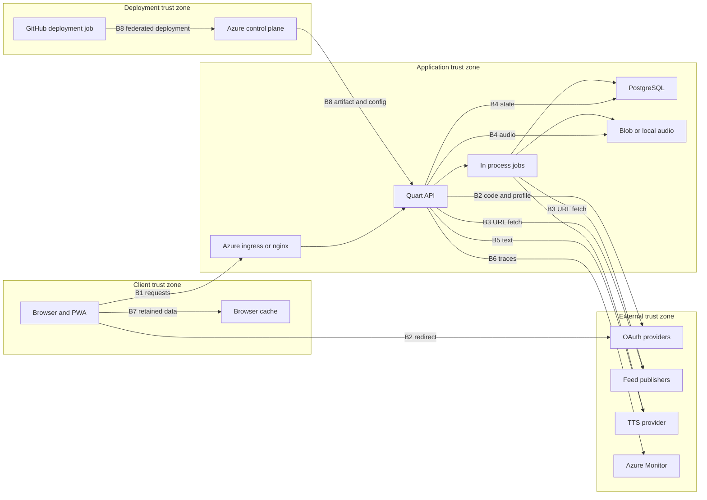

## Executive summary

The nine modeled gaps have repository-level remediations: persisted opaque identity,
single-use OAuth state/PKCE, DNS-pinned public-network feed fetching, owner-authorized
audio, bounded work, private browser-state cleanup, external-processing opt-ins,
telemetry scrubbing, and source deployment/runtime privilege separation.
Production rollout and existing cloud/GitHub configuration remain operator obligations;
no live penetration test, IAM change, or deployment has been performed.

### Post-remediation security re-review

**2026-10-31:** a read-only security reviewer reported no additional vulnerabilities
in the reviewed changes in the current checkout. This is a scoped review result,
not a guarantee that the application has no other issues, nor an independent
verification of every original remediation or the deployed environment.

The reassessment requested review of authentication/OAuth, feed network access,
audio ownership and shared storage, browser identity transitions, request
admission/CSRF, telemetry, and deployment/database privilege boundaries. The
reviewer returned no finding details or per-surface coverage evidence; do not
interpret its negative result as proof of exhaustive coverage.

The service-context check-in could not be answered because the user was
unavailable. Multi-user/private-content sensitivity, Internet exposure, and actual
ingress/cloud policy remain unconfirmed assumptions. The existing residual-risk
and operator-action columns below therefore remain applicable. No fresh test run,
live penetration test, dependency vulnerability scan, Docker execution, migration,
or deployed IAM inspection was performed for this re-review.

**Historical baseline:** the detailed system model, threats, rankings, and numbered
source citations below describe commit `73f7c4b`, before this remediation. Read those
citations against that revision, not shifted lines in the updated checkout. They are
preserved as the rationale for the fixes, not claims that the original vulnerabilities
remain in the remediated source. The following status supersedes their implementation
descriptions.

### Remediation status

| Threat | Repository control | Evidence surface | Remaining boundary |
|---|---|---|---|
| TM-001 | Random opaque credentials, persisted hashes/expiry, identity type checks, rotation/revocation, single-use signup; legacy cookies rejected | `session.py:SessionManager`; `test_session.py`, `test_auth_security.py`, real PostgreSQL auth/signup contracts | Apply migration `e6f0a1b2c3d4`; existing users sign in again. Browser cleanup cannot revoke a server session while offline. |
| TM-002 | Browser/provider/callback-bound state consumed atomically before exchange; PKCE S256; generic upstream errors | `oauth_service.py:OAuthService`; `test_oauth_security.py`, `test_auth_csrf.py`, auth contracts | OAuth provider registration and production callback origins must agree. |
| TM-003 | HTTP(S) public destinations only; all DNS answers checked and pinned; redirects revalidated; no environment proxies; IPv4/IPv6/IDNA bypass defenses | `feed_fetcher.py:SafeFeedResolver`; `test_feed_fetch_safety.py` | Public HTTP feeds remain supported. Infrastructure egress controls add defense in depth. |
| TM-004 | Generation/stream metadata join through the owning feed; authenticated full/range streaming; bounded provider reads; shared keys retain separate post links, newest-owner LRU access and reference-safe deletion | `audio_service.py:AudioService`; owner-filtered repositories; `test_audio_security.py`, PostgreSQL audio contracts | Apply migration `f7a1b2c3d4e5`. Private native-media caching depends on deployed no-store headers. |
| TM-005 | Independent 5 MiB wire/decoded feed limits, redirect/entry/content bounds, four non-waiting feed slots, per-feed dedup; two synthesis slots, 20,000 characters, 10 MiB audio, 120-second timeout; API body/rate bounds | feed safety/admission tests; audio/request security tests; `azure_tts.py` stops and drains canceled SDK work | Gates are process-local, not distributed. Feedparser still creates intermediate objects before the entry cap. Speech cancellation depends on the SDK finishing/stopping; capacity is retained while draining. Apply provider budgets and reassess limits before scaling workers/replicas. |
| TM-006 | API/auth/audio network-only/no-store; legacy private caches purged; account/logout/expiry reset protected state across tabs; late responses canceled; pending identity probes hide/inert private UI and gate requests while preserving same-account reader/playback position | Frontend privacy unit/browser suites, including real built-worker online/offline and same-account revalidation behavior | Private articles/audio intentionally do not work offline. If storage and BroadcastChannel are both denied, immediate cross-tab signaling is unavailable; visible-tab revalidation remains. |
| TM-007 | TTS/background processing off by default; publisher resources stripped/gated by operator plus per-account consent; no-referrer and restrictive CSP; traces/logs scrubbed before export; SQL parameters hidden | Processing/telemetry/CSP canaries; frontend publisher-request tests; nginx configuration contracts | Operator must assess processor consent, budgets, telemetry reader RBAC and retention. Explicit telemetry exports traces/application logs rather than enabling automatic unfiltered pipelines. |
| TM-008 | Operator-only RG-scoped provisioning; new narrow runtime-deploy identity; main-only reviewed production job; immutable images/modules/actions/artifacts; no app secrets in deployment job | Configuration contracts, Bicep/Compose/nginx validation, immutable reference provenance | Existing broad assignments/federations and GitHub secrets are NOT revoked by source edits. Check inherited permissions, actual reviewer/branch controls, and live deployment. |
| TM-009 | Non-root images, dropped capabilities, required distinct credentials, isolated DB/backend, loopback frontend, production HTTPS/key/debug validation, explicit migrations and restricted runtime DB role | Real PostgreSQL migration/runtime-role/ownership/SCRAM regressions; API contracts; configuration tests | Trusted external TLS termination and Azure PostgreSQL 16 rollout still require operator verification. Docker images were not built/run in this environment. |

**Rollout:** follow the updated README and operator scripts. Migrate with the
administrator, regrant existing/new tables, and run the app only as `myfeeds_runtime`.
Do not put migration credentials into runtime settings. Review and revoke legacy
cloud access deliberately; source configuration is not evidence of deployed policy.

**Admission boundary:** a coarse, process-local 1,200-request/minute client-address
allowance runs before database session resolution. Account-scoped allowances then
limit reads to 120/minute and mutations to 60/minute; anonymous requests use the
validated peer address instead. Only explicitly trusted ingress CIDRs may supply
one numeric `X-Real-IP`. Compose trusts its fixed nginx `/32`; development and
standalone deployments trust no forwarding headers by default. Shared NAT/ingress
addresses still share the coarse allowance. Configure trusted real-client-address
handling and infrastructure limits deliberately before scaling.

### Remediation verification

Executed under WSL with the locked Python development environment and an isolated,
SCRAM-enforced PostgreSQL 18 instance using the restricted runtime role:

```text
uv run --frozen --extra dev pytest tests/unit tests/contract tests/integration --tb=short --cov=app --crap
```

**539 tests passed.** CRAP uses branch coverage and threshold **30**. The leading
advisory hotspots are `_parse_entry` (76.14, complexity 29, 61.7% coverage),
`update_category` (67.03, complexity 10, 17.1% coverage), and `mark_all_read`
(44.23, complexity 11, 35.0% coverage). These existing parser/category/read-state
paths merit focused tests/refactoring separately; scores do not invalidate the
passing security regressions or establish exploitability.

The fresh frontend run passed **225 unit tests** and the production TypeScript/PWA
build. The focused post-review browser suite passed **5 privacy tests**, including
the built worker and retained scroll/menu/media state. **7 configuration contracts**
and both production/development Compose validation passed. Earlier broad browser
and identity/feed/deployment reports are supplemental evidence, not fresh whole-suite
claims. Docker image execution and live Azure/GitHub policy were not tested.

The final incremental mutation run selected request admission/origin handling,
shared-link deletion/LRU cleanup, standalone feed-URL validation, and the three
generated factory mutants for pre-authentication gate initialization:

```sh
uv run --frozen --extra dev mutmut run --max-children 2 \
  "app.api.middleware.request_security.*" \
  "app.main.x_create_app__mutmut_29" \
  "app.main.x_create_app__mutmut_30" \
  "app.main.x_create_app__mutmut_31" \
  "app.application.services.audio_service.*delete_audio*" \
  "app.infrastructure.jobs.audio_cleanup.x_cleanup_cache_by_size*" \
  "app.infrastructure.feed_fetcher.feed_fetcher.x_validate_feed_url*"
uv run --frozen --extra dev mutmut results
```

Of **278 selected mutants**, **193 were killed and 85 survived**; none in this
selected run were suspicious, timed out, skipped, unassociated with tests, or
left unchecked. Broader exploratory runs included timeouts/unassociated tests
and an interrupted expansion; those are not counted as successful validation.
The generated factory IDs are specific to this source state.

Mutation-driven assertions now detect standalone scheme-validation weakening
(`x_validate_feed_url__mutmut_16`), `max_size_mb * 1025 * 1024` rather than the
required `max_size_mb * 1024 * 1024`
(`x_cleanup_cache_by_size__mutmut_4`), and a missing shared-cache lookup key
(`AudioService.delete_audio__mutmut_8`); all three were killed on the final run.
All 10 selected shared-link deletion mutants and all three coarse-gate factory
mutants were killed.

Inspected survivors include case-only `Origin`/`Referer` header-name changes
(`x_verify_mutation_origin__mutmut_16`/`20`), which are equivalent for Quart's
case-insensitive headers, and `<` versus `<=` at the exact cache-size limit
(`x_cleanup_cache_by_size__mutmut_9`), which leaves files unchanged but changes
the early-return/database-query path. Remaining survivors are advisory
test-quality findings, not classified collectively as equivalent or harmless;
prioritize additional boundary/error-path assertions rather than weakening
production controls to kill mutants. Mutation testing is not an exhaustive
security proof.

## Scope and assumptions

- **Runtime scope:** `backend/app`, `backend/start.sh`, `frontend/src`, `frontend/nginx.conf`, and their production images. This is a Quart/SQLAlchemy/PostgreSQL API plus a React/Vite PWA, with RSS/Atom ingestion, OAuth, and TTS/cache integrations (`backend/pyproject.toml`; `frontend/package.json`; `backend/app/main.py:create_app`).
- **Deployment scope:** `infra`, `.github/workflows/deploy.yml`, `azure.yaml`, root/component Dockerfiles, and Compose configuration. CI/control-plane threats are distinguished from remotely reachable application threats.
- **Excluded:** test execution, exploit attempts, live Azure/GitHub configuration inspection, dependency vulnerability enumeration, developer-agent tooling under `.agents`/`.specify`, and hypothetical endpoints. Tests/specifications describe intent but are not proof of runtime enforcement.
- **A1 - production profile:** assume the Bicep-defined, IP-restricted Azure App Service deployment, with private PostgreSQL/Blob endpoints. Rules are source intent, not confirmed deployed state (`infra/main.bicep:134-155,177-185,257-311`). Compose is an alternate profile, not the Azure network architecture.
- **A2 - user isolation:** assume multiple OAuth users and private subscriptions/reading history. Ordinary post/category/feed ownership checks support that expectation (`backend/app/application/services/post_service.py:get_post`; `backend/app/application/services/feed_service.py:get_feed`; `backend/app/application/services/category_service.py:get_category`). Single-user use lowers cross-user impact, not authentication-integrity risk.
- **A3 - untrusted publishers:** URLs submitted by users and all returned feed content are attacker-influenceable. An attacker may operate or compromise a feed already subscribed to by an allowed user.
- **A4 - confidentiality:** feed URLs may contain bearer-like query parameters, and content may be nonpublic. TTS and offline caching are intentional features, but user approval for processing private feeds is not established.
- **A5 - scale/control plane:** assume a small deployment; the Azure startup uses one Hypercorn worker. GitHub environment reviewer/branch protections and actual IAM scope are unknown (`backend/start.sh`; `infra/setup-github.sh:28-39`).

**Context validation:** the assumption check-in was provided before this report. The subsequent autopilot instruction requested autonomous decisions without questions, so A1-A5 remain explicitly unconfirmed; they are not represented as user-approved facts.

**Open questions that change ranking:** Is deployment really IP-restricted, and who shares those allowed networks? Are all feeds public and all users mutually trusted? Are external TTS/offline retention acceptable for private content? Does the production GitHub environment restrict branches and require independent approval? Actual exposure can raise the runtime priorities below; verified single-user/public-content use can lower confidentiality priorities.

## System model

### Primary components

| Component | Runtime role and evidence |
|---|---|
| Browser/PWA | React UI sends cookie-bearing API requests; Workbox retains API, image, and audio responses (`frontend/src/services/api.ts:61`; `frontend/src/sw.ts`). |
| Quart API/static host | Registers auth, category, feed, post, and audio routes under `/api`; serves frontend assets/client routes and `/health` (`backend/app/api/routes/__init__.py:register_routes`; `backend/app/main.py:create_app`). Azure uses the combined root image; Compose uses nginx to serve the SPA and proxy `/api` (`Dockerfile`; `frontend/nginx.conf`). |
| Application services/PostgreSQL | User-owned feeds/categories/posts and per-user read state; SQLAlchemy persists state. Post listing joins feeds and filters by owner (`backend/app/infrastructure/persistence/repositories/post_repository.py:get_posts_for_user`; `backend/app/infrastructure/persistence/models/user.py`). |
| In-process jobs | Startup launches feed refresh, audio generation, and audio cleanup. API subscription/refresh requests additionally launch ingestion tasks (`backend/app/main.py:123-125`; `backend/app/api/routes/feeds.py:add_feed,create_feed,refresh_feed`). No separate queue service is evidenced. |
| Feed network/parser | aiohttp retrieves URLs; feedparser parses RSS/Atom. HTML is sanitized during ingestion (`backend/app/infrastructure/feed_fetcher/feed_fetcher.py`; `backend/app/application/services/feed_service.py:_fetch_and_save_posts`). |
| OAuth providers | GitHub, Google, and Microsoft authorization/token/user-info flows; custom cookies hold application identity (`backend/app/infrastructure/oauth/providers.py`; `backend/app/infrastructure/oauth/oauth_service.py`; `backend/app/infrastructure/oauth/session.py`). |
| TTS/cache | Azure Speech with managed identity in Azure, or online Edge TTS by settings default; generated MP3s/timings use local files or Blob Storage (`backend/app/config/settings.py:Settings`; `backend/app/infrastructure/tts/azure_tts.py`; `backend/app/infrastructure/tts/edge_tts_service.py`; `backend/app/infrastructure/tts/cache_provider.py`). |
| Telemetry | Conditional Azure Monitor setup instruments inbound ASGI and outbound HTTP clients and exports Python logs (`backend/app/config/telemetry.py:setup_telemetry`). |
| Build/deployment, not runtime | Manual Actions workflow uses production-environment OIDC, azd provisioning, and remote ACR build/deploy (`.github/workflows/deploy.yml`; `azure.yaml`). |

README's Azure description says "No Azure Speech"; current infrastructure provisions Speech and sets `TTS_PROVIDER=azure`. This model follows executable configuration rather than that stale description (`infra/main.bicep:221-242,302-303`).

### Data flows and trust boundaries

- **B1: Browser -> ingress -> API.** Cookies, JSON, URL/query parameters, UUIDs, and Range headers cross HTTP(S). Azure specifies HTTPS-only, TLS 1.2 minimum, and IP/SCM deny-default rules; Compose nginx/backend HTTP ports have no corresponding TLS terminator in-repo. Session cookies are HttpOnly/SameSite=Lax and Secure in production, but are unsigned. UUID routing, some type/length checks, ordinary ownership checks, and production security headers exist; no application rate-limit or general CSRF enforcement was identified in the registered routes/factory (`infra/main.bicep:265-282`; `backend/app/main.py:add_security_headers`; `backend/app/infrastructure/oauth/session.py`; `backend/app/api/routes`).
- **B2: Browser/API <-> OAuth providers.** Authorization redirects, codes, access tokens, client credentials, and profile data cross browser HTTPS redirects and fixed-provider HTTP-client requests. A random state value is generated, but not persisted/compared at callback; pending OAuth profile data is then entrusted to an unsigned cookie (`backend/app/infrastructure/oauth/oauth_service.py:get_authorization_url,_fetch_token,_fetch_user_info`; `backend/app/api/routes/auth.py:login,callback,complete_signup`). OAuth bearer tokens are used for user-info retrieval; durable storage of those tokens is not evidenced.
- **B3: API/jobs <-> feed publishers and server-reachable destinations.** User URLs and returned XML/HTML cross outbound HTTP(S). Initial URL checks allow HTTP/HTTPS and require netloc, with a 2,048-character cap. Fetching uses a 30-second total timeout and a declared 5 MiB Content-Length check, but no destination-address/redirect policy or actual decoded-body byte limit. Ingestion sanitizes content/summary and bounds some entry fields (`backend/app/domain/feed_management/services/feed_validator.py:validate_url_format`; `backend/app/infrastructure/feed_fetcher/feed_fetcher.py:_fetch_url`; `backend/app/domain/feed_management/entities/post.py:create`).
- **B4: API/jobs -> PostgreSQL and audio storage.** Profile/subscription/read state, article content, MP3s, and timings cross SQL connections, filesystem calls, or Blob HTTPS. Azure configures database TLS, private endpoints, Blob shared-key disablement, and managed-identity Blob access. The app receives the PostgreSQL administrator credential; no separate restricted runtime DB role is evidenced. Local audio paths are operator-configured; public audio-route keys must match 64 lowercase hex characters (`infra/main.bicep:134-185,295-305`; `backend/app/infrastructure/tts/cache_provider.py`; `backend/app/api/routes/audio.py:_CACHE_KEY_RE`). Compose instead publishes the DB port with default credentials (`docker-compose.yml:db`).
- **B5: API/jobs -> external TTS.** Stripped article text crosses the selected provider SDK/network connection. Azure Speech uses `DefaultAzureCredential`; Edge TTS uses an online provider without application credentials. A periodic job processes eligible posts even without a user audio request; this is not strictly lazy-only behavior. Batch size five limits each periodic pass, not API-triggered synthesis or text length (`backend/app/infrastructure/tts/azure_tts.py:synthesize_with_timings`; `backend/app/infrastructure/tts/edge_tts_service.py:synthesize_with_timings`; `backend/app/infrastructure/jobs/audio_generation.py:generate_pending_audio`).
- **B6: API/HTTP clients -> telemetry operator.** Request/dependency traces and logs may carry operational/user-derived values to Azure Monitor when enabled. Public ingestion/query endpoints are acknowledged by infrastructure; exporter scrubbing, exact SDK URL capture, and reader RBAC are not established by source. Error handlers also log supplied error messages (`backend/app/config/telemetry.py`; `backend/app/api/middleware/error_handler.py:handle_api_error`; `infra/main.bicep:202-216`).
- **B7: API/feed data -> browser DOM and persistent browser storage.** HTML reaches DOMPurify before `dangerouslySetInnerHTML`; nh3 supplies server-side defense. External image requests remain possible. Workbox caches non-auth API GETs by request URL in one shared API cache, with a one-day expiry; audio/images persist up to seven days. Auth requests bypass caching, but logout does not clear these caches (`frontend/src/components/PostContent.tsx`; `backend/app/infrastructure/sanitization/html_sanitizer.py`; `frontend/src/sw.ts`; `frontend/src/contexts/AuthContext.tsx:logout`).
- **B8: Developer/GitHub job -> Azure control plane -> runtime artifact.** Source, dependency/base images, environment secrets, and an OIDC token cross checkout/build/deploy and Azure management APIs. Federation binds the repository and environment, and workflow GitHub permissions are limited to contents-read/id-token-write; setup grants Azure Contributor plus RBAC Administrator subscription-wide. Production approval/branch restrictions are not configured in the setup script, though they may exist externally. Lockfiles/frozen installs constrain packages, but Actions references and some build images/tools are mutable tags (`infra/setup-github.sh:28-39`; `.github/workflows/deploy.yml`; `Dockerfile`; `azure.yaml`).

#### Diagram



## Assets and security objectives

| Asset | Why it matters | Security objective (C/I/A) |
|---|---|---|
| Application identity and pending OAuth identity | Controls which user owns/reads/modifies state; must represent a verified provider identity, not browser assertions. | C/I |
| Profiles, subscription URLs, categories, reading history | Email/profile information and interests; URLs may be credentials. | C/I |
| Article text, audio, word timings, offline copies | Private-feed content remains sensitive after conversion or local retention. | C/I |
| OAuth client secrets, DB credential, signing configuration, managed identity | Enable provider exchanges and privileged persistence/service access. | C/I |
| API/DB capacity, ingestion progress, synthesis budget | Small shared infrastructure can be exhausted by unbounded work. | A |
| Deployment identity, source, image/config integrity | A compromised job can alter service behavior or subscription resources. | C/I/A |
| Logs/traces and telemetry access | Necessary for detection, but can become a secondary disclosure surface. | C/I/A |

Asset evidence: `backend/app/infrastructure/persistence/models/user.py`; `backend/app/domain/feed_management/entities/post.py`; `backend/app/config/settings.py`; `infra/main.bicep:295-310`; `infra/setup-github.sh:34-36`; `frontend/src/sw.ts`.

## Attacker model

### Capabilities

- An actor on an allowed Azure source network can submit arbitrary API requests/cookies and register an OAuth identity; no separate user-admission allowlist is evidenced in signup.
- A malicious or compromised publisher can change feed bodies, response sizes, URLs via redirects, and served content without gaining access to the app's ingress.
- A user may learn a victim UUID or audio key through sharing, browser history, logs, or another disclosure. Random UUIDs/hash keys are not assumed enumerable.
- A subsequent user of the same browser profile can encounter retained responses. Local-browser access is distinct from an arbitrary remote attacker.
- A compromised deployment author, runner, or dependency can act within the permissions of an admitted deployment job. This is a separate supply-chain prerequisite.

### Non-capabilities

- An arbitrary internet host cannot bypass correctly deployed Azure source-IP denial by merely forging a forwarding header.
- No arbitrary code execution, OAuth-provider compromise, SQL injection, sanitizer bypass, Azure token extraction, or direct private-Blob/DB access is assumed.
- Feed-fetch SSRF uses GET without attacker-controlled arbitrary headers. Access to protected metadata/managed-identity tokens is not established; reaching a private IP is not equivalent to credential theft.
- Attackers cannot guess arbitrary private article content from a SHA-256 key. They can derive a key only when synthesis text, voice, format, and version are known.
- No cross-user confidentiality requirement is assumed for content deliberately published publicly; rankings requiring private content are conditional.

## Entry points and attack surfaces

| Surface | How reached | Trust boundary | Notes | Evidence (repo path / symbol) |
|---|---|---|---|---|
| Auth login/callback/signup/me/logout | `/api/auth/login/<provider>`, `/<provider>/callback`, `/complete-signup`, `/me`, `/logout` | B1/B2 | Browser-controlled cookies, codes, errors, signup JSON. | `backend/app/api/routes/auth.py`; `backend/app/infrastructure/oauth/session.py` |
| Category CRUD | `/api/categories`, `/api/categories/<uuid>` | B1/B4 | Name/position JSON; ownership and 25-category cap exist. | `backend/app/api/routes/categories.py`; `backend/app/application/services/category_service.py` |
| Feed CRUD/assignment/refresh | `/api/feeds`, `/<uuid>`, `/<uuid>/refresh`, `/api/categories/<uuid>/feeds` | B1/B3/B4 | Both creation variants fetch submitted URLs; refresh schedules work; 100-feed cap. | `backend/app/api/routes/feeds.py`; `backend/app/application/services/feed_service.py` |
| Posts/counts/read-state | `/api/posts`, `/unread-counts`, `/<uuid>`, `/read-state`, `/<uuid>/read-state` | B1/B4/B7 | Query/cursor filters; ordinary ownership checks; detail GET auto-marks read. | `backend/app/api/routes/posts.py`; `backend/app/application/services/post_service.py` |
| Audio metadata/generation/streaming | `/api/posts/<uuid>/audio`, `/api/audio/<key>` | B1/B4/B5 | Generation checks session presence but not owner; streaming has no session check; whole object loaded before Range slicing. | `backend/app/api/routes/audio.py`; `backend/app/application/services/audio_service.py:get_or_generate_audio` |
| Feed XML/HTML and redirects | Subscription validation, manual and periodic ingestion | B3/B7 | Third-party body enters parsing, storage, and browser rendering. | `backend/app/infrastructure/feed_fetcher/feed_fetcher.py`; `frontend/src/components/PostContent.tsx` |
| Job selection and cached artifacts | Startup loops; API-triggered ingestion/synthesis; Blob/filesystem | B3/B4/B5 | Provider-neutral cache/cleanup and system generation bypass ordinary user request checks by design. | `backend/app/main.py:startup`; `backend/app/infrastructure/jobs`; `backend/app/infrastructure/tts/cache_provider.py` |
| Telemetry/error sinks | Instrumented inbound/outbound requests and exception/error logging | B6 | Treat user-supplied errors/URL parameters as potentially sensitive. | `backend/app/config/telemetry.py`; `backend/app/api/middleware/error_handler.py` |
| PWA storage and external images | Service-worker GET interception; sanitized article/image rendering | B7 | Global caches are not account-partitioned; markup sanitization does not prevent tracking images. | `frontend/src/sw.ts`; `frontend/src/components/PostContent.tsx` |
| Static hosting and health | `/`, SPA fallback, assets, `/health` | B1/B8 | No application identity required; Azure root image adds headers, Compose nginx SPA does not inherit Quart headers. | `backend/app/main.py:serve_frontend,health_check`; `frontend/nginx.conf` |
| Deployment/admin configuration | Manual Actions dispatch, setup script, environment settings, remote builds | B8 | Not an API route; requires deployment/supply-chain influence. | `.github/workflows/deploy.yml`; `infra/setup-github.sh`; `Dockerfile` |
| Alternate Compose listeners | Published database/backend/frontend ports | B1/B4 | Host firewall/bind policy determines reachability; database defaults are unsuitable outside trusted local use. | `docker-compose.yml`; `docker-compose.override.yml` |

## Top abuse paths

1. **TM-001 - impersonate or squat an account.** Reach ingress -> submit an unsigned full-session cookie naming a known victim UUID -> ownership checks trust that supplied identity -> read/delete the victim's state. Alternatively, forge pending provider/profile data -> complete signup for an unregistered provider identity -> poison identity registration. Knowing a victim UUID/provider identifier is a prerequisite for targeted impact, not assumed enumeration.
2. **TM-002 - substitute the browser's OAuth identity.** Obtain a valid unused code for the application's registered callback -> cause a victim browser to visit the callback carrying that code -> missing state binding accepts it -> victim is placed into the attacker's account/pending identity. Requires a deliverable code and victim interaction; does not inherently reveal the victim's provider token.
3. **TM-003 - use the app as a network deputy.** Submit a private-address feed URL, or change an existing publisher response to redirect internally -> fetcher follows its request path with server network reach -> probe GET-accessible internal services or induce side effects. Content extraction requires a parseable response/observable returned fields; arbitrary internal response disclosure is not assumed.
4. **TM-004 - bypass private-post audio isolation.** Obtain another user's post UUID -> call audio generation using any accepted session -> unscoped post lookup returns/generates its audio and timings -> read article text via speech/timings. A known/derived cache key also reaches an unauthenticated stream, independent of fixing full-session cookies.
5. **TM-005 - exhaust shared processing/budget.** Repeatedly refresh or request uncached audio, or serve a large chunked/compressed feed -> absent decoded-body/concurrency/text limits multiply memory, DB work, and synthesis -> delay all users or inflate Azure Speech usage. Periodic batch limits and feed-count caps do not bound simultaneous API work.
6. **TM-006 - expose a prior user's offline data.** User A caches `/api/posts` or a detail response -> logs out without purging caches -> user B signs in on the same browser -> network failure/timeout lets the same URL use A's retained response. The direct browser-storage exposure is established; exact UI replay should be verified with a browser test.
7. **TM-007 - leak private reading data to a secondary recipient.** Private article ingestion triggers automatic external TTS; publisher images can report a reading event; instrumented URLs/errors may enter telemetry -> recipients or overly broad telemetry readers observe text, interests, or token-bearing URLs. TTS processing is evidenced; exact telemetry fields and service retention require validation.
8. **TM-008 - pivot from delivery to subscription control.** Compromise code/action/build input admitted to a production job -> obtain its environment-bound OIDC identity -> use subscription Contributor/RBAC Administrator privileges to change resources or access assignments -> compromise artifacts, configuration, or cloud data beyond this app.
9. **TM-009 - attack an exposed local-production stack.** Operator runs Compose on an untrusted network -> published PostgreSQL port admits known default credentials, or HTTP exposes profile/content traffic -> attacker reads/modifies DB state or observes traffic. Requires actual host/network exposure; this is not the Azure private-endpoint configuration.

## Threat model table

| Threat ID | Threat source | Prerequisites | Threat action | Impact | Impacted assets | Existing controls (evidence) | Gaps | Recommended mitigations | Detection ideas | Likelihood | Impact severity | Priority |
|---|---|---|---|---|---|---|---|---|---|---|---|---|
| TM-001 | API caller | Allowed ingress; victim UUID for targeted impersonation, or provider identifier for signup squatting. | Spoof/tamper full and pending cookies. | Account data compromise and identity-registration poisoning. | Identity, profiles, subscriptions, history | HttpOnly/Secure/Lax, TTL, UUID parsing (`session.py:create_session,get_session`); provider uniqueness (`models/user.py`). | JSON has no signature; server key is unused by custom cookies; no revocable server session. | Replace both cookie types with opaque server-side sessions; bind pending provider identity to server-held verified data; rotate/expire sessions, reject future-issued timestamps, and fail startup on invalid signing configuration if signing is used. | Invalid-session/signature metrics; signup identity conflicts and unusual account/network changes; do not log cookies. | **High:** cookie fields are directly trusted; source-IP restriction limits who can attempt it. | **High:** defeats all ownership checks depending on session identity. | high |
| TM-002 | Attacker with OAuth identity | Valid application-bound unused code and victim navigation to allowed callback. | Spoof OAuth transaction/login CSRF. | Wrong-account login; victim activity stored under attacker identity. | Identity, subscriptions, history | Random state, fixed providers and configured callback (`oauth_service.py:get_authorization_url`; `auth.py:get_redirect_uri`). | Callback never checks stored state; no evidenced PKCE binding. | Persist short-lived single-use state bound to browser/provider/callback; compare before exchange; use a validated OAuth client flow and PKCE where supported. | State-missing/mismatch/replay counters, provider outcome logs without codes/tokens. | **Medium:** code acquisition/delivery and interaction constrain exploitation. | **Medium:** wrong-account activity, not proven victim-provider takeover. | medium |
| TM-003 | API user or subscribed publisher | URL influence or publisher redirect control; GET-reachable target. | Abuse outbound trust through SSRF. | Internal probing/GET side effects; conditional parseable-data disclosure. | Internal services, network isolation, availability | HTTP(S)/URL-length checks and timeout (`feed_validator.py:validate_url_format`; `feed_fetcher.py:_fetch_url`). | No private/loopback/link-local destination denial, DNS binding, port policy, or redirect validation. | Enforce a shared fetch policy for validation and ingestion: restrict ports, reject URL credentials/nonpublic IPv4/IPv6, validate every redirect, and connect only to validated resolved addresses; add controlled egress/proxy rules. | Blocked destination/redirect metrics; anomalous resolved ranges; redact feed URL query values. | **High:** submitted URLs are fetched; publishers retain influence after signup. | **High, conditional:** internal service impact depends on reachable unauthenticated targets; no demonstrated managed-identity theft. | high |
| TM-004 | Another user or key holder | Known victim post UUID or audio key; any accepted session for generation. | Bypass authorization at audio lookup/stream. | Private article/audio/timing disclosure and unauthorized synthesis. | Content, audio, budget | UUID routing; 64-hex stream key; Blob private endpoint (`audio.py`; `infra/main.bicep:storage`). | `get_or_generate_audio` never uses `user_id` to authorize; stream route has no session; content hash is not authorization. | Authorize post through an owner-filtered query before cache lookup/generation; require owner-authorized stream resolution or short-lived scoped capabilities; retain system-only job entrypoint separately. | Cross-owner denial counters; high audio generation/key-request rates; avoid logging capability URLs. | **Medium:** victim identifiers must be learned; random IDs are not assumed guessable. | **High if private feeds:** audio and timing text bypass ordinary post isolation; lower for public-only data. | high |
| TM-005 | API caller or publisher | Allowed requests or control of an ingested feed body. | Deny service/amplify expensive fetch and synthesis work. | Worker/DB starvation, stalled ingestion, unexpected TTS spending. | Capacity, progress, budget | 30-second fetch timeout, declared-size cap, 100 feeds/user, five-post periodic audio batch, cleanup (`feed_fetcher.py`; `feed_service.py:MAX_FEEDS_PER_USER`; `jobs/audio_generation.py`; `jobs/audio_cleanup.py`). | No actual decoded-size cap; body read in full; no evidenced shared job dedup/admission control or synthesis-text cap; full audio load before Range handling. | Stream-count decoded bytes; cap entry count/body/text; limit per-user/global work; deduplicate in-flight feed/post jobs, bound synthesis duration/retries, and read audio ranges without loading entire objects. | Queue/in-flight work, process memory, fetch decoded bytes, synthesis characters/cost, refresh latency alerts. | **Medium:** timeout/caps help, but chunked/compressed bodies and repeated API jobs bypass their intent. | **Medium:** shared small-service interruption and bill growth, not proven code execution. | medium |
| TM-006 | Subsequent browser user | Same browser profile containing A's cache; B accesses matching URL during network failure/timeout. | Read/replay retained cross-account responses. | Prior user's subscriptions/content/history disclosed locally. | Offline data, privacy | Auth routes excluded; API one-day/audio seven-day expiry (`sw.ts`); logout clears React auth state (`AuthContext.tsx:logout`). | Cache names/keys are account-independent; no logout/account-switch purge; HTTP private/no-cache does not itself isolate Workbox Cache Storage. | Scope cache identity to authenticated account; purge private caches and app state on logout/switch, coordinate open tabs/SW, and define explicit offline unlock/retention behavior. | Browser tests for A-to-B offline/timeout replay and multi-tab logout; local cache lifecycle diagnostics without content. | **Medium:** requires shared browser and cache/fallback conditions. | **Medium:** limited to retained data rather than arbitrary remote account access. | medium |
| TM-007 | Publisher, secondary processor, or telemetry reader | Nonpublic content, tracking-image load, or sensitive values captured by enabled telemetry. | Disclose data across processing/rendering/logging boundaries. | Private text/interests or URL credentials reach unintended recipients. | Content, subscriptions, credentials, telemetry | nh3/DOMPurify and link noreferrer; managed-identity Speech; conditional telemetry (`html_sanitizer.py`; `PostContent.tsx`; `azure_tts.py`; `telemetry.py`). | Sanitization is not image privacy; background TTS is automatic; no evidenced sensitive-feed policy or explicit exporter redaction. | Require an allowed processing policy before private-feed TTS; offer local/disabled synthesis; strip/proxy remote images by policy; redact query secrets/error details before exporting; constrain telemetry RBAC/retention. | Check emitted telemetry with synthetic canary parameters; audit reader access and processor configuration; observe permitted egress destinations. | **Medium:** external TTS is automatic; sensitivity/retention and exact trace capture are unknown. | **Medium, conditional:** potentially high for credential-bearing captured URLs or sensitive article text. | medium |
| TM-008 | Deployment/supply-chain attacker | Influence over an admitted production job, runner, action, or build dependency. | Elevate control-plane impact through broad federated privileges. | Subscription-wide resource/config/role changes and malicious deployment. | Deployment identity, images, secrets, cloud data | Manual dispatch, environment-bound federation, narrow GitHub token permissions, frozen lockfile installs (`deploy.yml`; `setup-github.sh:28-36`; `Dockerfile`). | Subscription-wide Contributor/RBAC Administrator; setup does not specify reviewer/branch gates; mutable action/tool/image tags; combined image defaults to root. | Split bootstrap/provision/runtime-deploy identities; scope roles to app resource group and constrain role-assignment privileges; require protected branches/reviewed environments; pin Actions/base tools by immutable identifiers and run runtime image as non-root. | Azure role/resource change and OIDC sign-in alerts; unexpected workflow ref/deployment/image-digest changes; independent environment approval audit. | **Low:** requires a separate delivery compromise; actual environment protections unknown. | **High:** current setup grants impact beyond the app. | high |
| TM-009 | Network peer/operator mistake | Compose DB/HTTP listeners exposed beyond trusted local host; defaults retained. | Bypass app via database credentials or unencrypted transport. | DB disclosure/tampering; HTTP traffic observation; SPA header protection absent. | DB state, profiles/content, local credentials | Container bridge, production cookie Secure setting; Azure profile separately enforces HTTPS/private endpoints (`docker-compose.yml`; `session.py:create_session`; `infra/main.bicep`). | DB port publishes by default with predictable defaults; no Compose TLS; Quart CSP does not cover nginx-served SPA. Secure cookies also make plain-HTTP production login unreliable. | Bind DB/backend to loopback or unpublish them; require nondefault DB credentials and restricted runtime role; use TLS termination for nonlocal use and matching nginx security headers; validate profile before exposure. | Host firewall/listener inventory, failed DB logins, unexpected external connections, configuration checks without exposing secrets. | **Low under A1:** alternate deployment/operator exposure prerequisite; high if reachable defaults are confirmed. | **High if exposed:** direct DB read/write bypasses OAuth. | medium |

Table evidence names resolve under the full paths listed in the system model and focus-path table. Recommended controls are not described as already implemented. TM-001 and TM-004 must be fixed independently: authenticated identities alone do not authorize audio. TM-003 containment does not replace TM-005 body/work limits.

## Criticality calibration

Priorities reflect the assumed small, IP-restricted Azure deployment, not an open internet multi-tenant SaaS. **No critical priority is asserted from this review.**

- **Critical:** demonstrated broadly reachable privileged code execution; demonstrated managed-identity theft enabling broad cloud control; mass sensitive-data compromise across an unrestricted public deployment with a verified exploit chain. No such complete chain was established here.
- **High:** unsigned-cookie impersonation of a known user's identity; cross-owner private audio disclosure; compromised deployment job exercising subscription-wide IAM/resource changes. These threaten security boundaries even when likelihood is reduced by ingress or prerequisite controls.
- **Medium:** targeted resource exhaustion on this small deployment; retained prior-user data on a shared browser; login CSRF placing victim activity in the wrong account. Raise where public reachability, sensitive content, or sustained critical-service disruption is confirmed.
- **Low:** `/health` revealing a generic status; publisher tracking of an otherwise public article in a consenting single-user context; short-lived stale nonsensitive feed metadata in the owner-partitioned response cache. These do not justify claiming identity compromise or privileged execution.

Assumptions most affecting risk: A1 reduces direct API likelihood but not subscribed-publisher attacks; A2/A4 determine private-audio/offline/TTS impact; A5 determines delivery-compromise likelihood. Opening ingress without first addressing TM-001 would materially worsen overall risk.

## Focus paths for security review

| Path | Why it matters | Related Threat IDs |
|---|---|---|
| `backend/app/infrastructure/oauth/session.py` | Replace browser-asserted full/pending identities; verify expiry, revocation, and malformed/future timestamps. | TM-001 |
| `backend/app/api/routes/auth.py` | Bind callbacks and signup to server-held OAuth transaction state. | TM-001, TM-002 |
| `backend/app/infrastructure/oauth/oauth_service.py` | Validate provider/redirect/state and supported PKCE behavior rather than just generating a state string. | TM-002 |
| `backend/app/domain/feed_management/services/feed_validator.py` | Centralize URL normalization and destination policy without relying on format checks. | TM-003 |
| `backend/app/infrastructure/feed_fetcher/feed_fetcher.py` | Enforce resolved-address/redirect policy and bounded decoded streaming for both metadata and post fetches. | TM-003, TM-005 |
| `backend/app/api/routes/feeds.py` | Bound and deduplicate create/refresh-triggered background work. | TM-003, TM-005 |
| `backend/app/application/services/audio_service.py` | Enforce ownership before all public generation/cache paths while preserving system-only generation. | TM-004, TM-005, TM-007 |
| `backend/app/api/routes/audio.py` | Resolve stream authorization and implement bounded range retrieval. | TM-004, TM-005 |
| `backend/app/infrastructure/tts/cache_manager.py` | Treat deterministic content keys as storage identifiers, not user-access capabilities. | TM-004 |
| `backend/app/infrastructure/tts/cache_provider.py` | Check provider access, object read limits, and private-audio lifecycle. | TM-004, TM-005 |
| `backend/app/infrastructure/jobs` | Review ingestion/audio admission, retries, fairness, cleanup, and automatic third-party processing. | TM-005, TM-007 |
| `frontend/src/sw.ts` | Verify account-bound cache keys, logout purge, offline access, and fallback replay. | TM-006 |
| `frontend/src/contexts/AuthContext.tsx` | Coordinate account transitions with persistent/private cache removal across tabs. | TM-006 |
| `frontend/src/components/PostContent.tsx` | Preserve sanitization and distinguish image tracking/privacy policy from script execution defense. | TM-007 |
| `backend/app/config/telemetry.py` | Inspect actual exported trace attributes and add explicit redaction/access controls. | TM-007 |
| `backend/app/api/middleware/error_handler.py` | Prevent sensitive provider/feed error details from leaking into logs/responses. | TM-007 |
| `infra/main.bicep` | Verify deployed ingress/private endpoints, service IAM, runtime DB privilege, and Speech/telemetry configuration. | TM-003, TM-004, TM-007, TM-008 |
| `infra/setup-github.sh` | Reduce subscription-level deployment/RBAC permissions and configure production admission controls. | TM-008 |
| `.github/workflows/deploy.yml` | Pin delivery dependencies and require protected ref/environment authorization. | TM-008 |
| `Dockerfile` | Pin build tool/base image provenance and remove unnecessary runtime root privilege. | TM-008 |
| `docker-compose.yml` | Eliminate exposed-default-credential DB access and distinguish local from nonlocal deployment. | TM-009 |
| `frontend/nginx.conf` | Add appropriate TLS-edge integration and SPA headers for the separate Compose hosting path. | TM-009 |

## Notes on use

This model covers checked-out source on `main` as reviewed on 2026-10-31. It does not certify the deployed service, third-party SDK internals, or absence of additional vulnerabilities. No exploit requests, deployment changes, production-code changes, or secret-value disclosures were made. Validate assumptions against actual deployments before treating conditional impacts as confirmed incidents.

Highest-value follow-through: verify full/pending-cookie tamper rejection, OAuth state mismatch/replay rejection, cross-user audio denial, private-address/redirect blocking, decoded feed-size enforcement, duplicate-job limits, and cross-account offline cache isolation. Use authorized test fixtures rather than real internal targets or private-user content.

Quality check:

- All discovered route families, static/health hosting, parser/job triggers, storage, telemetry, and alternate listeners are represented.
- B1-B8 each map to at least one abuse path; runtime and CI/control-plane prerequisites remain separate.
- Existing controls have source anchors; recommendations and conditional impacts are explicitly distinguished.
- User-context confirmation was superseded by the autopilot instruction, with unconfirmed assumptions/open questions retained.
- Citations use existing repository paths/symbols; architecture includes one compact Mermaid diagram; threat IDs and priorities are stable.
