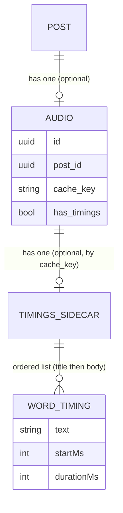

# Phase 1 Data Model: Read-Along Audio Highlighting

**Feature**: `003-read-along-highlight` | **Spec**: [spec.md](spec.md) | **Plan**: [plan.md](plan.md)

This feature adds one domain value object, a sidecar persistence record, a small marker on the existing `audio` row, an API DTO field, and client-side view/preference models. No new database table.

---

## 1. `WordTiming` (domain value object) — backend

One spoken word within a clip. Immutable, no identity (value object per constitution Principle I).

**Location**: `backend/app/domain/audio/value_objects/word_timing.py`

| Field         | Type  | Notes                                                                                                     |
| ------------- | ----- | --------------------------------------------------------------------------------------------------------- |
| `text`        | `str` | The engine's **source-text token** (e.g. `2024`, `don't`, `Hello`). Verbatim; not normalized server-side. |
| `start_ms`    | `int` | Start offset from the beginning of the audio, in milliseconds (≥ 0).                                      |
| `duration_ms` | `int` | Duration of the spoken word in milliseconds (≥ 0).                                                        |

Derived: `end_ms = start_ms + duration_ms`.

**Validation rules**:
- `start_ms ≥ 0`, `duration_ms ≥ 0`.
- Within a clip, entries are **ordered by `start_ms` non-decreasing** (spoken order = title then body).
- `text` is non-empty (pure-punctuation/whitespace tokens are never emitted as boundaries and thus never stored).

**Relationships**: Belongs to exactly one Audio clip. A clip has an **ordered list** `list[WordTiming]` spanning title-then-body. The list is persisted as a sidecar (§3), never in Postgres.

**Representation**: frozen dataclass (`@dataclass(frozen=True, slots=True)`). Equality by value. A dict form `{"text", "startMs", "durationMs"}` is used only at the persistence/serialization boundary (infrastructure/API), so the domain value object does not depend on any wire format.

---

## 2. `Audio` (existing entity) — added marker

**Location**: `backend/app/domain/audio/entities/audio.py` + `backend/app/infrastructure/persistence/models/audio.py`

Add a single field to the existing entity and model:

| Field         | Type   | Default | Notes                                                                                                                                                                                  |
| ------------- | ------ | ------- | -------------------------------------------------------------------------------------------------------------------------------------------------------------------------------------- |
| `has_timings` | `bool` | `false` | `true` iff a valid word-timing sidecar was written for this clip's `cache_key`. Queryable projection of sidecar existence; enables timings-aware bulk selection by the background job. |

- **Migration**: Alembic revision adds `audio.has_timings BOOLEAN NOT NULL DEFAULT false`. Existing rows default to `false`, which (combined with the version bump) makes every legacy clip eligible for backfill.
- **Repository mapping**: `SQLAlchemyAudioRepository._to_entity` / `_to_model` read/write `has_timings`. The current `_to_entity` hard-codes some fields (`voice_id`, `access_count`); `has_timings` is mapped from the column, not hard-coded.
- The timing **data** is not on this entity — only the boolean marker.

State note: a clip is valid with `has_timings = false` (it simply plays without read-along). No state machine beyond `false → true` on successful (re)generation.

---

## 3. Word-Timings Sidecar (persistence record) — backend

A JSON file holding the ordered timings for one clip, keyed by the clip's cache key.

**Path**: `audio_cache/<cache_key[:2]>/<cache_key>.json` (mirrors the MP3 path from `AudioCacheManager.get_file_path`, `.json` extension).

**Schema** (see [contracts/word-timings.schema.json](contracts/word-timings.schema.json)):

```json
{
  "schemaVersion": 1,
  "voiceId": "en-US-AriaNeural",
  "words": [
    { "text": "Hello", "startMs": 120, "durationMs": 300 },
    { "text": "world", "startMs": 430, "durationMs": 280 }
  ]
}
```

| Field                | Type        | Notes                                                                                              |
| -------------------- | ----------- | -------------------------------------------------------------------------------------------------- |
| `schemaVersion`      | integer     | Forward-compat marker (starts at `1`).                                                             |
| `voiceId`            | string      | Voice used (debugging/traceability; optional to consume).                                          |
| `words`              | array       | Ordered `WordTiming` records. May be empty (engine emitted no boundaries → treated as no timings). |
| `words[].text`       | string      | Source token, verbatim.                                                                            |
| `words[].startMs`    | integer ≥ 0 | Start offset (ms).                                                                                 |
| `words[].durationMs` | integer ≥ 0 | Duration (ms).                                                                                     |

**Lifecycle** (shares the clip's cache key):
- **Write**: during (re)generation, after the MP3 is written, atomically (write temp + rename) alongside the MP3; then set `audio.has_timings = true`.
- **Read**: on the READY API response and by the timings-aware short-circuit.
- **Corrupt/partial/missing**: any read failure (missing file, invalid JSON, non-conforming shape) is treated as **no timings** — never an error (FR-018). A corrupt sidecar makes the clip re-eligible for backfill.
- **Delete/reclaim**: removed together with its MP3 by the existing cache cleanup (orphan `.json` with no live `cache_key` is deleted the same way orphan `.mp3` is).

---

## 4. Audio metadata DTO — API boundary

The READY response of `GET /posts/{id}/audio` gains an optional `wordTimings` array. Full contract in [contracts/audio-api.md](contracts/audio-api.md).

```json
{
  "postId": "…",
  "status": "ready",
  "url": "/api/audio/<cache_key>",
  "durationSeconds": 123.4,
  "format": "mp3",
  "wordTimings": [
    { "text": "Hello", "startMs": 120, "durationMs": 300 }
  ]
}
```

- `wordTimings` is **present only when** a valid sidecar exists; **omitted** otherwise (no `null`, no `[]`-vs-missing ambiguity for "unusable").
- Ordering is spoken order (title then body). Same `{ text, startMs, durationMs }` shape as the sidecar `words`.

---

## 5. Client view models — frontend

### 5.1 `WordTiming` (TS type)
`frontend/src/types/index.ts`:
```ts
export interface WordTiming { text: string; startMs: number; durationMs: number; }
```
`AudioInfo` gains `wordTimings?: WordTiming[]`.

### 5.2 Display word sequence (derived, in-memory)
Built by [wrapWords.ts](contracts/read-along-client.md) from the title element + body container:

| Field        | Type          | Notes                                                             |
| ------------ | ------------- | ----------------------------------------------------------------- |
| `index`      | number        | Sequential position across title-then-body (0-based).             |
| `normalized` | string        | Lowercased, edge-punctuation-stripped token used for alignment.   |
| `element`    | `HTMLElement` | The `<span data-ra-index>` wrapping this word (highlight target). |

### 5.3 Alignment result (derived, computed once per post)

| Field             | Type         | Notes                                                                                                             |
| ----------------- | ------------ | ----------------------------------------------------------------------------------------------------------------- |
| `enabled`         | boolean      | `true` iff ≥90% of timing tokens aligned in order and no over-long divergence run. Decided up-front (FR-018/019). |
| `timingToDisplay` | `Int32Array` | For each timing index, the display-word index to highlight (`-1` if unmapped).                                    |
| `matchedRatio`    | number       | Fraction of timing tokens aligned (diagnostic / gate input).                                                      |

### 5.4 Read-Along Preferences (persisted)
`useReadAlongPreferences` over `localStorage`:

| Key                    | Type    | Default | Notes                        |
| ---------------------- | ------- | ------- | ---------------------------- |
| `readAlong.highlight`  | boolean | `true`  | "Highlight while playing".   |
| `readAlong.autoScroll` | boolean | `true`  | "Auto-scroll while playing". |

Independent; keyboard-operable; per device/browser only (FR-009–013). Unset keys read as `true`.

### 5.5 Active-word runtime state (transient, not persisted)

| Field                | Type   | Notes                                                                                        |
| -------------------- | ------ | -------------------------------------------------------------------------------------------- |
| `activeTimingIndex`  | number | Greatest `i` with `startMs[i] ≤ currentMs`; `-1` before first / after end. Held across gaps. |
| `activeDisplayIndex` | number | `timingToDisplay[activeTimingIndex]`, or `-1`. The single highlighted span.                  |

Recomputed on a `requestAnimationFrame` cadence from media time; at most one word highlighted at any time (FR-003/024).

---

## Entity relationships (summary)



Client-only models (display words, alignment result, preferences, active-word state) are not persisted server-side.
